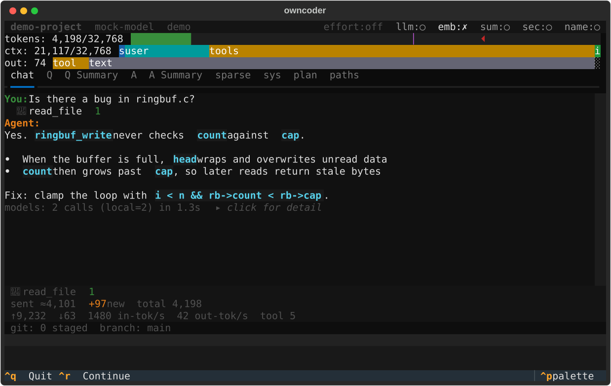
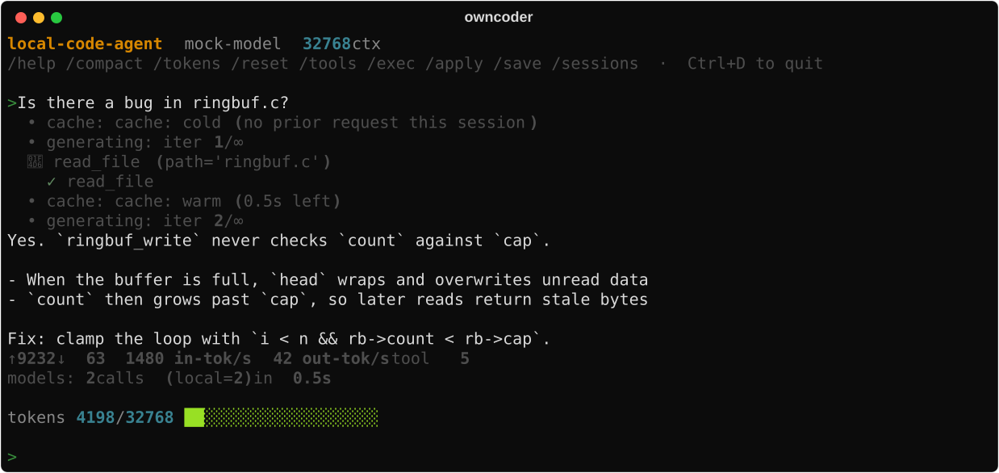
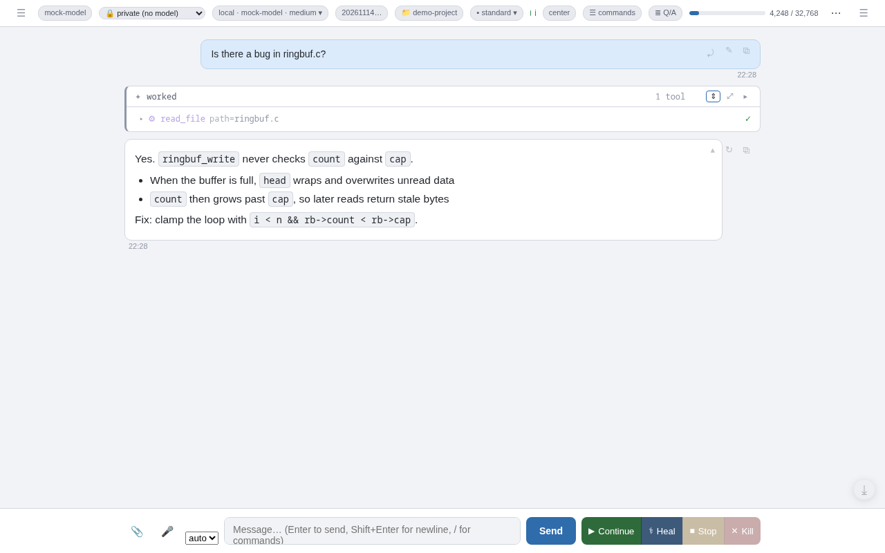
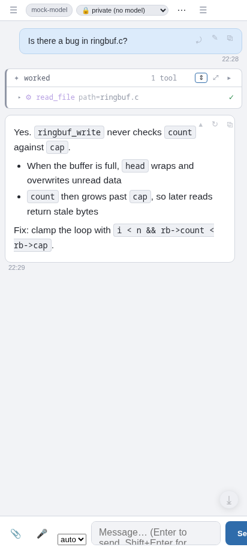

[](https://github.com/adderek/owncoder/actions/workflows/tests.yml)

# owncoder

Local-first coding agent. It runs against your own llama.cpp / vLLM / Ollama server or any
OpenAI-compatible API, and keeps code on your machine unless you configure otherwise. It is
mostly used to understand and navigate large, unfamiliar codebases (C/C++, assembler and other
low-structure code), for multi-day investigations on remote lab machines over SSH, and for long
sessions that stay coherent through notes, recall and context compaction.

<p align="center">
  
</p>

Docs: <https://adderek.github.io/owncoder/>. Screenshots in this file come from a demo sandbox
driven by a scripted fake model (`website/tools/shots*.py`), not from a real model run.

## Interfaces

| Interface | Start with |
|---|---|
| Terminal UI (Textual tabs: chat, Q/A, sys) | `agent chat --ui textual` |
| Text flow (plain scrolling output) | `agent chat --ui simple` |
| Browser | `agent chat --ui http`, or `--http-sidecar` next to the terminal UI |
| Phone / remote clients (relay, end-to-end encrypted; Android client) | see [relay](https://adderek.github.io/owncoder/relay/) |
| One-shot | `agent run "your prompt"` (`--json` for a machine-readable result) |

The UI is chosen by `agent chat --ui X`, then `AGENT_UI_MODE`, then your saved preference, then an
interactive picker. Valid values: `textual`, `simple`, `http`. Details:
[interfaces](https://adderek.github.io/owncoder/interfaces/).

<p>
  
  
  
</p>

## Install

Linux and macOS:

```sh
curl -LsSf https://raw.githubusercontent.com/adderek/owncoder/master/install.sh | sh
```

It installs [uv](https://docs.astral.sh/uv/) if missing, installs owncoder into an isolated
environment and starts the first-start wizard. With uv already present:

```sh
uv tool install git+https://github.com/adderek/owncoder
```

Windows runs through WSL2 only. In PowerShell:

```powershell
irm https://raw.githubusercontent.com/adderek/owncoder/master/install.ps1 | iex
```

This sets up WSL2 if needed and runs the Linux installer inside it. Keep projects on the Linux
filesystem, not under `/mnt/c/`.

Prerequisites: `git` (required); `ripgrep` (optional, faster search); `bubblewrap` or `firejail`
on Linux (the command sandbox; without one the shell and web tools refuse to run). Upgrade with
`uv tool upgrade owncoder`. Both `owncoder` and `agent` are installed and are the same program.
More: [install](https://adderek.github.io/owncoder/install/).

## Quick start

```sh
owncoder setup    # pick provider + model, verify with a test completion, write the config
cd your-project
agent init        # required once per project; add --skip-index to skip only the indexing
agent chat
```

If the API key is already exported (for example `OPENROUTER_API_KEY`), the wizard stores a
reference such as `api_key = "env:OPENROUTER_API_KEY"` instead of the key, so the config file is
safe to sync or paste into a bug report. Indexing is optional for ordinary languages and useful
for assembler and other low-structure code. More:
[quickstart](https://adderek.github.io/owncoder/quickstart/).

## What it does

- **Local-first endpoints**: llama.cpp, vLLM, Ollama, LM Studio, OpenRouter, DeepSeek or any
  OpenAI-compatible URL; per-purpose model roles and failover.
  [configuration](https://adderek.github.io/owncoder/configuration/)
- **Sandbox and guards**: shell and web tools run in a bubblewrap/seccomp sandbox; permission
  prompts, path grants, prompt-injection scanning, output redaction, audit log, loop guard.
  [security](https://adderek.github.io/owncoder/security/)
- **Code understanding**: tree-sitter + sqlite-vec RAG, LLM summary pyramids, assembler and
  binary analysis, call/dependency graph, per-project knowledge base kept current while idle.
  [code-understanding](https://adderek.github.io/owncoder/code-understanding/)
- **Planning**: plans stored under `.agent/plans/` (`/plan`, `/plans`, `/abort-plan`, `/pause-plan`),
  with recovery notes when a plan stalls.
- **Subagents on mixed models**: `spawn_agents` fans independent subtasks out to strong and weak
  models with per-group concurrency limits. Off by default (`[parallel] enabled`).
  [subagents](https://adderek.github.io/owncoder/subagents/)
- **Remote lab tools**: SSH (`remote_exec`, `remote_copy`), serial consoles, shared USB devices.
  All off by default, declared in the user config layer only (`agent remote trust` pins host keys).
- **Memory and recall**: notes, facts, Q/A log and session history, distilled and compacted by
  the LLM; `recall_facts` re-checks constraints after compaction.
- **MCP and skills**: external MCP servers and a skills directory extend the toolset.
- **Per-model compiled prompts**: static prompts and tool results are compacted for the active
  model and cached (`agent prompts`).

## Configuration

`owncoder setup` writes `~/.config/agent/agent.toml`. By hand, copy
[`agent.toml.example`](agent.toml.example) to the project root or that path. Models are named
entries; `[models]` assigns them to roles:

```toml
[models]
default    = "local-coder"
embeddings = "nomic-local"

[models.local-coder]
base_url   = "http://localhost:8080/v1"
api_key    = "env:MY_LLM_KEY"          # or a literal such as "sk-…" / "local"
model      = "qwen3-coder-30b"
ctx_window = 32768

[models.nomic-local]
base_url   = "http://localhost:8080/v1"
api_key    = "local"
model      = "nomic-embed-text"
dimensions = 768
```

Environment overrides need no file: `AGENT_LLM_BASE_URL`, `AGENT_LLM_API_KEY`, `AGENT_LLM_MODEL`,
`AGENT_EMBEDDINGS_BASE_URL`, `AGENT_EMBEDDINGS_MODEL`. Full reference:
[configuration](https://adderek.github.io/owncoder/configuration/).

## Known limits

- Beta software; expect rough edges and changing config keys.
- Local models sometimes emit malformed or text-form tool calls. The harness parses, repairs or
  nudges, but a weak model can still waste turns.
- The loop guard may stop repetitive work and ask you to redirect the agent.
- The command sandbox has no network by design; internet access goes through dedicated tools.
- Windows is supported only through WSL2.

## Alternatives

Similar tools:

* claude code (best for complex tasks)
* gemini cli (good even in free version)
* openai chatgpt codex (currently best offer)
* hermes (good and works locally - **use it instead of my owncoder** )
* cursor (IDE that works)
* windsurf (IDE that's on develop, but cheaper than cursor and sometimes has better features)

## Development

From source (the directory must be named `agent`; the tests resolve the package from the parent
directory):

```sh
git clone https://github.com/adderek/owncoder.git agent
cd agent
uv venv .venv
uv pip install -e ".[dev]"
.venv/bin/pytest            # skips e2e; add -m e2e to run those
website/build               # build the docs site (needs uv); --serve to preview
```

Security model and secret handling: [`SECURITY_EXTRA.md`](SECURITY_EXTRA.md). Do not hand real
secrets to the agent; redaction is best-effort.
