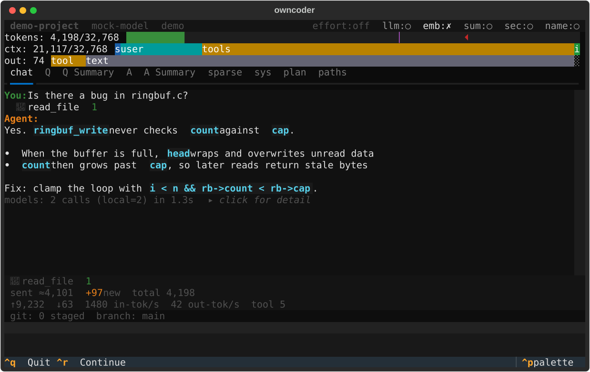

# owncoder

**Local-first coding agent with a real sandbox — runs against your own llama.cpp / vLLM / Ollama or any OpenAI-compatible API.**

## Interfaces

| Interface | Launch |
|---|---|
| Textual TUI | `agent chat --ui textual` |
| Plain text flow | `agent chat --ui simple` |
| Browser UI | `agent chat --ui http` |
| Remote clients (Android app) | over an end-to-end-encrypted relay |

## Why

- **Local-first.** Point it at your own llama.cpp, vLLM or Ollama server, or any OpenAI-compatible API.
- **Sandbox + guards.** Commands run in a real sandbox, with guards around what the agent may do.
- **Built for big, unfamiliar or low-structure code**, such as assembler.

## Next

- [Install](install.md)
- [Quickstart](quickstart.md)
