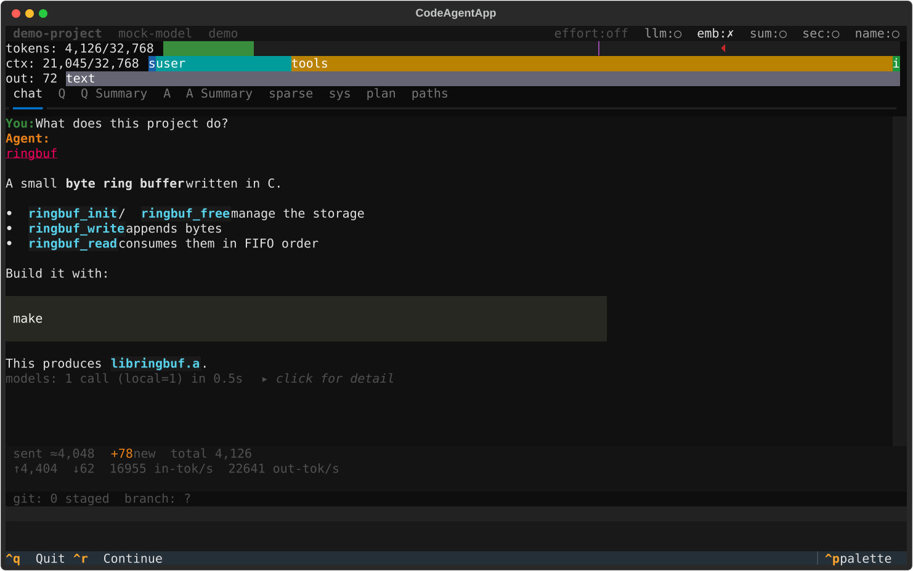
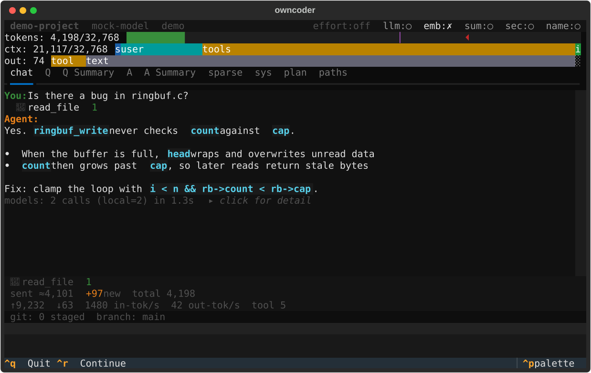
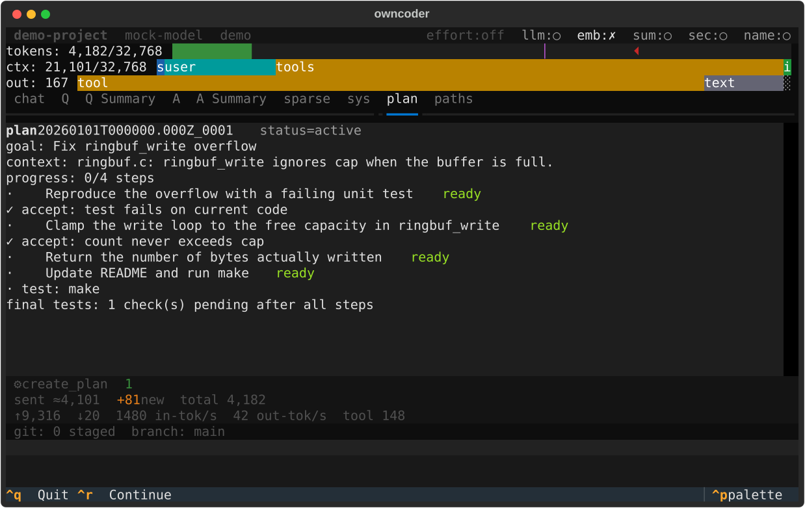
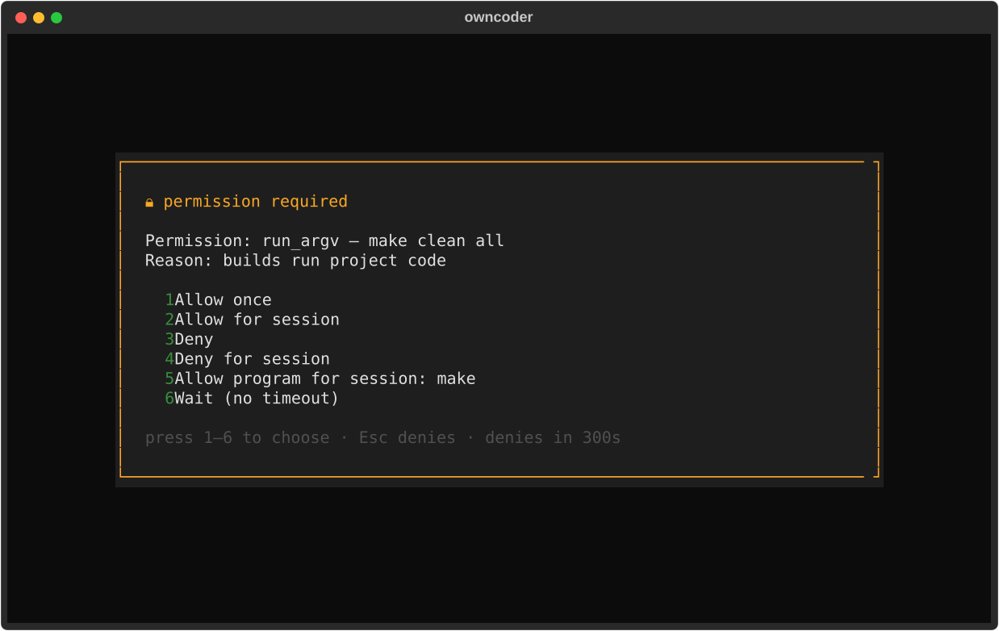
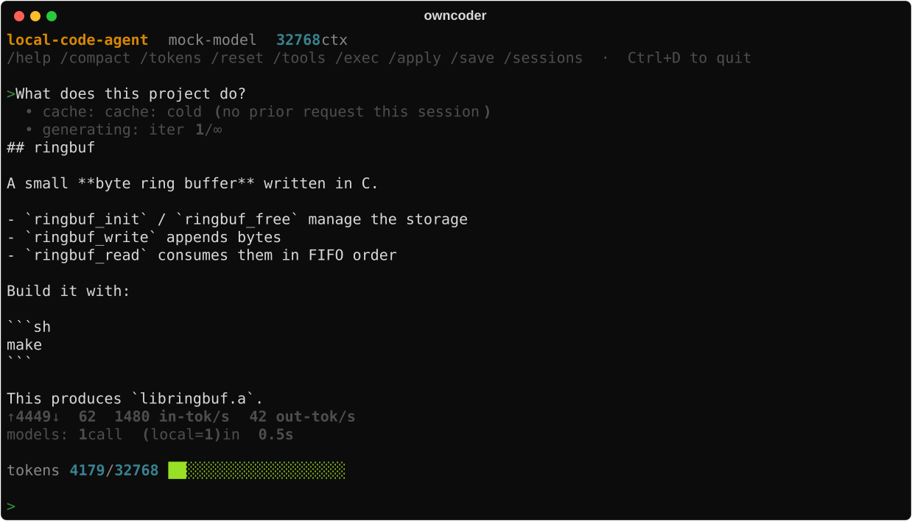
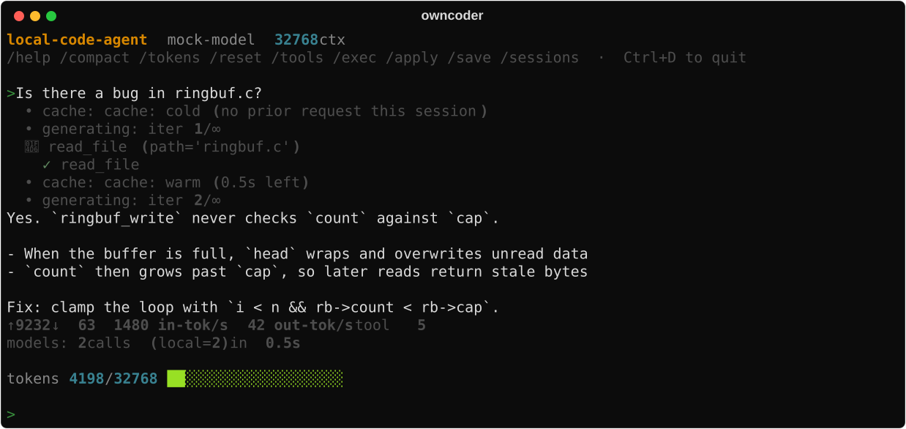
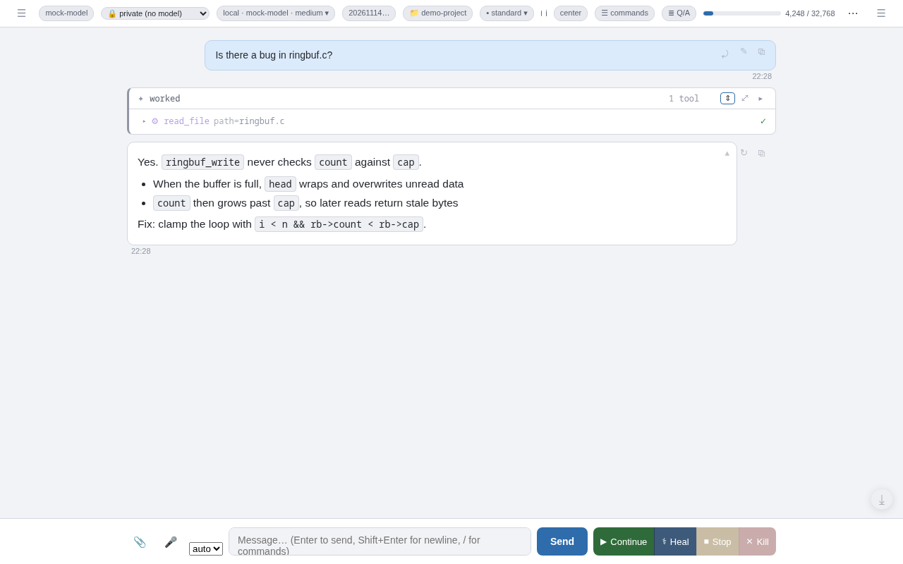
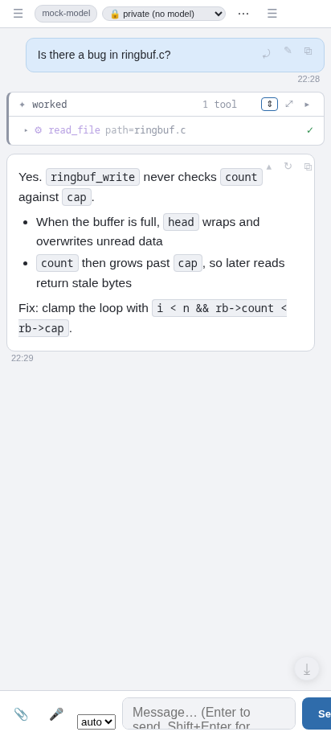
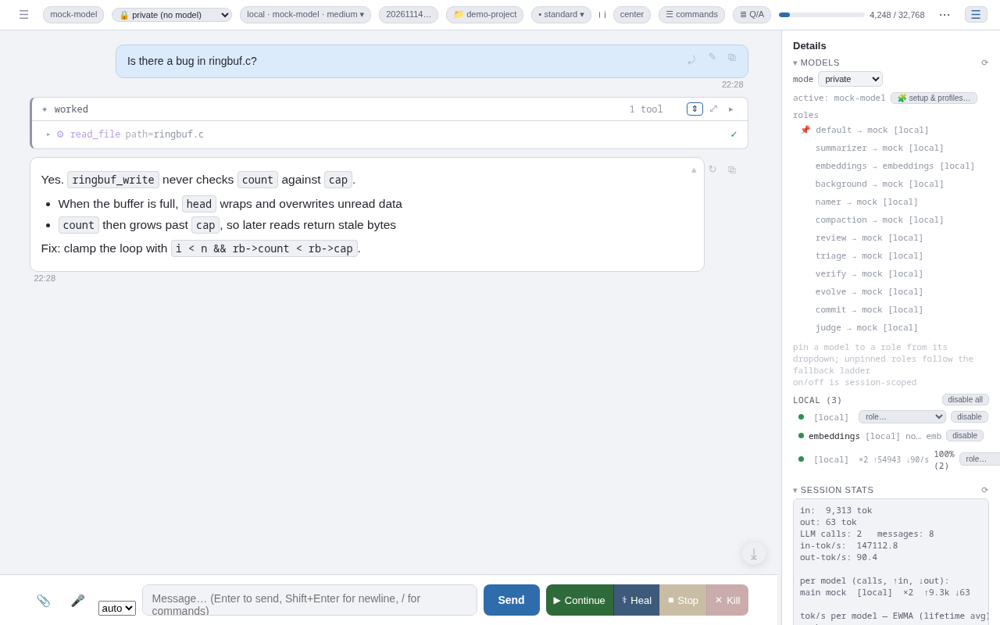

# Interfaces

owncoder has three interactive front ends and a non-interactive one-shot mode. They share the same agent, tools and sessions. Console commands `agent` and `owncoder` are the same entry point.

| Interface | Start command | Best for |
|-----------|---------------|----------|
| Full-screen TUI (`textual`) | `agent chat --ui textual` | Daily work in a terminal: tabs, token and context bars, permission prompts |
| Text flow (`simple`) | `agent chat --ui simple` | Small terminals, SSH, copy-paste friendly output |
| Browser (`http`) | `agent chat --ui http` | Side panels, phone access, voice input |
| Sidecar | `agent chat --ui textual --http-sidecar` | Terminal UI plus a companion browser view |
| One-shot | `agent run "<prompt>"` | Scripts and CI |

!!! note "About the screenshots"
    All screenshots on this page come from a demo sandbox with a scripted fake model. The layout is real; the conversations are not.

## Full-screen TUI (`textual`)



A tabbed terminal UI. Tabs are reachable with function keys:

| Key | Tab |
|-----|-----|
| F1 | chat |
| F2 / F3 | Q / Q Summary |
| F4 / F5 | A / A Summary |
| F6 | sparse |
| F7 | sys |
| F8 | plan |
| F9 | paths |

Token and context bars show how much of the window is used. Tool calls, plans and questions from the agent are rendered inline.





When a tool call needs your permission, the agent stops and asks; you answer in place.



Relevant `[ui]` keys: `syntax_highlight`, `show_token_count`, `chat_wrap` (`wrap`, `nowrap`, `last used`), `round_summary`.

## Text flow (`simple`)



Flowing terminal output with slash commands (for example `/bg` for background jobs) and readline-style input history.



## Browser (`http`)

Desktop and phone layouts of the same single-page app:

| Desktop | Phone |
|---------|-------|
|  |  |

Side panels:

- Left: sessions, access paths, remote hosts, usb, plan, schedules, backlog.
- Right: models, session stats, LLM calls, context, memory, background jobs, git history.



The microphone button records audio in the browser and posts it to the host, which transcribes it (see [Relay & Android](relay.md) for the `[speech]` setup). Browsers only grant microphone access in a secure context: HTTPS or loopback.

On start the agent prints a URL with a per-start token, for example `http://127.0.0.1:8180/?token=...`. Open it to get in. Other browsers can ask to connect; the operator approves in the agent's terminal or an open tab. Manage approved browsers with `agent http-clients` (actions: `list`, `revoke`, `clear`, `approve`, `deny`).

`[ui]` keys:

```toml
[ui]
mode = "http"            # picker default only, see below
http_host = "127.0.0.1"  # default is "0.0.0.0" (all interfaces)
http_port = 8180         # walks forward up to +19 if busy
http_tls_auto = "lan"    # "lan" | "always" | "off"
# http_tls_cert = "/path/to/cert.pem"
# http_tls_key  = "/path/to/key.pem"
# allowed_hosts = ["192.0.2.10"]   # names you type in the browser URL bar
connect_approval = true
```

`http_tls_auto = "lan"` generates a self-signed certificate when the server is bound beyond loopback and no cert/key is configured; `"always"` does so on loopback too; `"off"` serves plain HTTP. `allowed_hosts` has the command-line equivalent `agent chat --allow-host HOST` (repeatable). `--allow-any-host` (`[ui] http_allow_any_host`) skips the Origin/Host check; the token or an approved browser is still required.

!!! warning "Security notes for the browser UI"
    - The server binds all interfaces by default. For local-only use set `http_host = "127.0.0.1"`.
    - The token URL is the credential. Anyone who has it can drive the agent; do not paste it into shared channels.
    - Plain HTTP sends the token and your prompts unencrypted over the network. Use TLS when the UI is reachable from other machines.

## Sidecar

A companion browser view that runs next to `textual` or `simple`. It mirrors the current turn and accepts chat input. Session switching, model management and stop controls stay in the terminal UI; use `--ui http` if you need them.

```
agent chat --ui textual --http-sidecar
```

or set `http_sidecar = true` under `[ui]`. The sidecar uses `http_host` and `http_port` and prints a `?token=` URL at start. It serves plain HTTP.

## One-shot: `agent run`

```
agent run "summarise the failing tests"
echo "explain src/main.py" | agent run
agent run --json "list TODO comments"
```

Without an argument the prompt is read from stdin. With `--json` the output is a JSON envelope and the exit code is 0 (done), 1 (error) or 2 (iteration or goal cap reached).

`agent serve` is something else: a browser for the RAG chunk index (`--port`, default 8765). It is not a chat UI.

## How the mode is chosen

The first match wins:

1. `agent chat --ui textual|simple|http`
2. Environment variable `AGENT_UI_MODE`
3. Saved choice in `.agent/ui_prefs.json`
4. Interactive picker at startup (your answer is saved for next time)

`[ui] mode` in the config file only sets the picker's default; it does not skip the picker. There is no `readline` mode: `simple` is the plain-terminal option.
