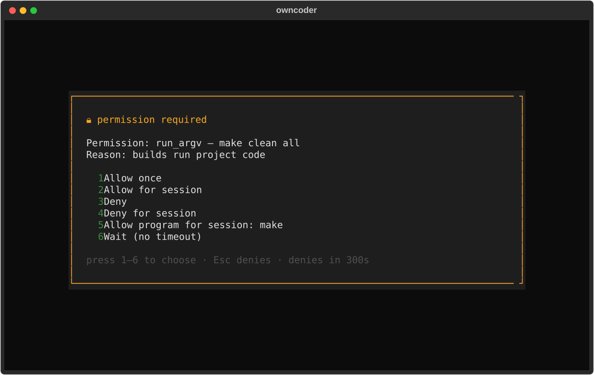

# Security

The sandbox and guards that constrain what the agent can do.

## Threat model in plain words

The model that drives the agent can be wrong, can be talked into things by text it reads (a web page, a file in a cloned repository, a tool result), and can run commands you did not intend. owncoder assumes this and puts barriers between the model's output and your machine.

What the barriers are for:

- Commands the agent runs should not read your secrets, write outside the project, or reach the network unless you allowed it.
- Risky actions should stop and ask you first.
- Text from untrusted sources should be treated as data, not instructions.
- A model stuck in a loop should be stopped and hand control back.

What they are not: a guarantee. See [Limits](#limits).

## Sandbox

Shell commands (`run_shell`, `run_argv`) run inside bubblewrap with a seccomp filter, or inside firejail. Inside the sandbox:

- Only `/usr` and the project root (plus paths you granted) are mounted. Secret files are masked and the agent's own control files (permissions, grants, audit, config) are read-only.
- The network is off. `security.network = "off"` is the default.
- Environment variables matching credential patterns (`*_TOKEN`, `*_KEY`, `AWS_*`, `GITHUB_*` and similar) are not passed in.
- CPU, wall time, memory, process count, file size and open-file limits apply (`cpu_seconds`, `wall_seconds`, `rss_mb`, `nproc`, `fsize_mb`, `nofile`).

```toml
[security]
sandbox_backend = "auto"   # auto | bwrap | firejail | none
require_sandbox = true     # default; refuse to run commands if no backend is found
network         = "off"    # off | on
```

`require_sandbox` defaults to true: with no backend available the agent refuses host execution instead of silently running unconfined. A project-level `agent.toml` can only tighten these settings, never loosen them, so a cloned repository cannot switch the sandbox off.

Network access can be enabled per command (`network = "on"`). With `network_isolation = "auto"` such a command gets its own network namespace through `pasta` when installed: internet and LAN work, host loopback services do not.

Paths outside the project need an explicit grant (the Access panel, the `request_path_access` tool, `/paths`). In your user config you can set a `[[security.grant_ceiling]]` list: every grant must lie under one of those entries, and a read-only entry can never become read-write. `/sandbox` shows the sandbox limits and what the last scan cost; `/paths check <path>` explains a verdict.

## Permissions and prompts

A policy layer sits above the sandbox. Each rule names a tool, an optional match on its main argument, and a verdict: `allow`, `ask` or `deny`. The first matching rule wins, and rules can only narrow what the lower layers already permit.

```toml
[permissions]
default       = "allow"   # allow | ask | deny
ask_timeout_s = 300.0     # no answer in this time = deny
builtin_rules = true      # ask before force-push, publish, sudo, raw egress ...

[[permissions.rules]]
tool    = "run_argv"
match   = "git push*"
verdict = "ask"
reason  = "pushing publishes work"

[[permissions.rules]]
tool    = "write_file"
match   = "deploy/**"
verdict = "deny"
```

An `ask` opens a prompt in the interface:



With no interactive interface (`agent run`, CI) an `ask` resolves to deny. Manage rules with `/permissions`.

## Private and air-gap modes

- `agent chat --incognito` persists nothing from the session.
- `agent chat --private` is incognito plus a hard requirement that every LLM endpoint is local.
- `agent chat --vault` persists everything encrypted at rest (Argon2id key from a passphrase, AES-256-GCM). Lose the passphrase and the data is gone. `agent vault` reads sealed files back. File names, sizes and times are not hidden.
- `security.airgap = true` (or `/security airgap on`) makes owncoder's own network features, such as web search, HTTP MCP transports and notify channels, refuse non-local targets. It also flags a non-local LLM endpoint.
- `[privacy]` routing can redact, force a local model, or block a turn when a secret shape would go to a remote endpoint.

Air-gap is enforced at the feature level. It is not a kernel firewall.

## Untrusted input

Output from MCP servers and web fetch tools is wrapped in a banner that marks it as data, not instructions. Known injection phrasings (such as "ignore previous instructions" or fake role tags) are named in the banner. The patterns are only a tripwire; the banner is applied to untrusted output whether or not a pattern matched. Control: `security.guard_tool_injection`, default true.

In the default `ultrasecure` agent mode the main agent has no direct web tools. It calls `ask_internet`, which starts a disposable subagent that alone holds `web_search` and `web_fetch`, in a fresh history. That subagent must return a structured `{answer, sources, quotes}` object re-written in its own words, and the result is scanned again before it reaches the main agent. Set `[agent] mode = "fast"` in your user config to give the main agent web tools directly.

## Secrets

- Tool output is redacted before it enters the model context: known credential shapes and values present in your config are masked (`security.redact_tool_output`, default true).
- Secret files (`.env`, `*.pem`, `.netrc`, `~/.ssh`, cloud credentials) are masked inside the sandbox.
- Keep API keys out of config files: `api_key = "env:MY_KEY_VAR"` reads the key from the environment.
- Free-account logins for web access can live in an encrypted credential pool (`[credpool]`, off by default) and are attached at the HTTP layer, so the internet subagent never sees them.

Redaction is best effort. It cannot know what is confidential to you. Do not show the agent secrets you cannot afford to leak, and prefer short-lived, scoped tokens.

## Guards

- `[loop_guard]` detects repeated identical tool calls and stops the loop.
- `[confidence_guard]` watches error rate, empty results and duplicate results; when a turn is going nowhere it makes the model state what it knows and what it is guessing, and it can emit `>>>BLOCKED` to hand control back.
- Shell near-duplicate detection and an attempt ledger remind the model what was already tried.
- `[checkpoints]` keeps pre-images of edited files so `/checkpoint` and `/undo` can roll back.

## Audit

Every sandboxed tool call is appended to `.agent/audit.jsonl` (rotated at 64 MiB). The file and the `.agent/audit/` directory are write-denied to the agent's own tools and to sandboxed commands.

## Optional layers

- **Action classifier** (`[classify]`, off by default): a small local model scores risky tool calls (safe, needs_review, destructive, exfiltration). In `advisory` mode it adds a note; in `enforce` mode a high score escalates to a prompt or a denial. It only ever narrows. See `/classify`.
- **Outer isolation:** run the whole agent in rootless Podman or a microVM. The wrapper stays outside the agent's control; the internal sandbox keeps working inside it. The repository's `SECURITY_EXTRA.md` has the commands.
- **Hooks:** hooks defined in a project config need your approval before they run (`/hooks`).

## Lab hardware

These tools are off by default, configured only in your user config (a project config may only set `enabled: false`), and each grant is deliberate:

- `[remote]`: `remote_exec` and `remote_copy` over SSH to hosts you list, with a dedicated key, a pinned host key (`agent remote trust`) and per-host confirmation.
- `[serial]`: UART consoles through USB-UART adapters (`serial_send`, `serial_read`, `serial_arm`).
- `[usb]`: share USB devices by id (and serial) with sandboxed commands.

These run outside the local sandbox or hand it hardware. List only disposable lab devices.

## Limits

- The sandbox has no network inside by default. Network work should go through the dedicated tools (`web_search`, `web_fetch`, `ask_internet`) or be done by you. Enabling `network = "on"` weakens this per command.
- A sandbox reduces risk; it does not remove it. A kernel or runtime bug, a permissive grant, or an approved prompt can still hurt.
- Redaction and injection scanning are pattern-based and can miss novel forms.
- Air-gap mode is feature-level, not a firewall.
- Remote, serial and USB tools give the agent the rights of the account or device you connected.
- For untrusted code, add an outer layer (container or microVM).
